<div align="center">


# SentinelFlow

**Real-time network threat detection with a live dashboard, PCAP replay, and explainable alerts mapped to MITRE ATT&CK.**

[](https://github.com/MeazbahMehedi/SentinelFlow/actions/workflows/tests.yml)


[](LICENSE)

[Features](#features) · [Screenshots](#screenshots) · [Quick start](#quick-start) · [Detection](#detection-engine) · [Architecture](#architecture) · [Testing](#testing-and-quality)

<br>

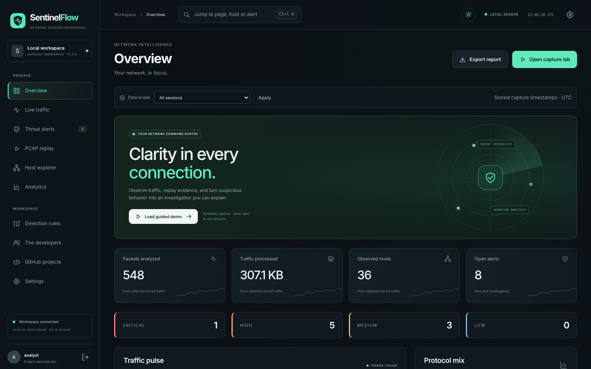

</div>

---

SentinelFlow turns packet metadata into evidence an analyst can act on. It analyzes live interface traffic or recorded PCAP files with nine behavioral detectors. Each alert records the observations that triggered it and its MITRE ATT&CK technique. Replays are deterministic, so an investigation can be reproduced packet for packet.

It runs entirely on your machine. You don't need API keys, a cloud service, a GPU or a JavaScript build step. Each account gets a private workspace.

## Features

**Detection**
- **Nine explainable detectors.** Port scans, internal host sweeps, SYN bursts, DNS bursts, DNS tunneling, authentication brute force, periodic beaconing, large outbound transfers, and indicator matches.
- **Flow-aware counting.** A bidirectional flow table identifies who opened each connection. Server replies and traffic captured mid-stream are never mistaken for scans.
- **MITRE ATT&CK mapping.** Every rule maps to an ATT&CK technique and tactic, shown in the UI and included in exports.
- **Threat intelligence.** Indicators can be IP addresses, CIDR networks or domains. Domain indicators match DNS queries for the domain and its subdomains.
- **Suricata EVE import.** Existing signature alerts join the same triage workflow.

**Investigation**
- **Live dashboard.** Counters, timeline and protocol mix update as packets are analyzed. Hover the timeline for per-bucket detail.
- **Deterministic PCAP replay.** Speeds from 0.25× to 32×, pause and resume, optional idle-gap skipping, and a session timeline with a marker for each detection.
- **Alert triage.** Filter by severity and status, update alerts in bulk, write analyst notes, and export an evidence JSON file per alert.
- **Host explorer.** An interactive conversation map, risk scores from open alerts, and per-host profiles showing services, top peers and activity window.
- **Analytics.** Rule hits, ATT&CK tactic distribution, top talkers and top destination services.
- **Command palette.** Press <kbd>Ctrl</kbd> + <kbd>K</kbd> to jump to any page, host, or alert number.

**Platform**
- **Private multi-account workspaces.** Each account has its own SQLite database. The identity database holds accounts and never stores traffic.
- **Hardened authentication.** Passwords are hashed. Failed sign-ins are throttled per client address and per account. A password change, or "sign out other browsers", invalidates every other session.
- **Dark and light themes.** Both themes are fully designed. The layout works down to phone widths.

## Screenshots

| Threat alert inbox | Alert investigation |
|---|---|
| 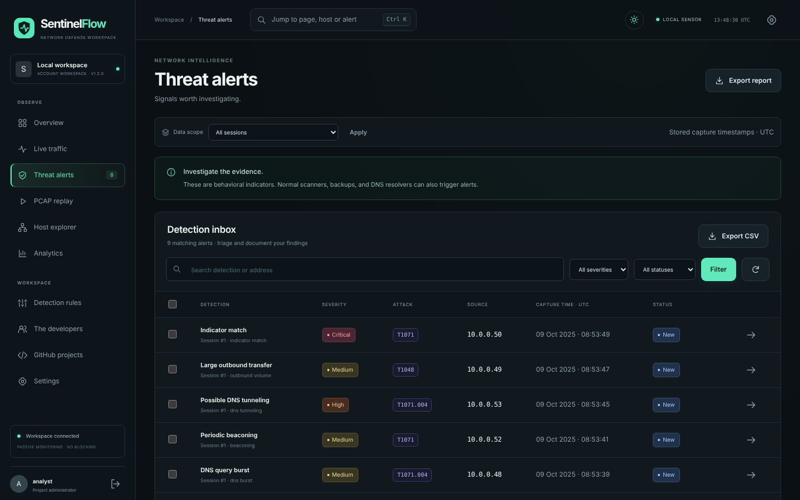 | 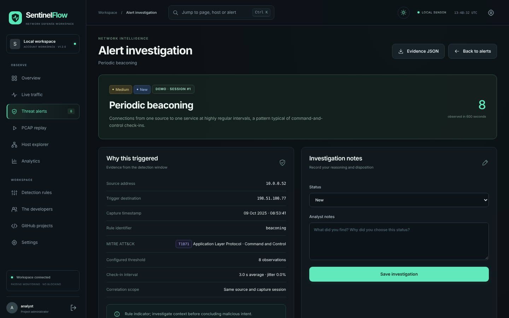 |
| **Host explorer and conversation map** | **Host profile** |
| 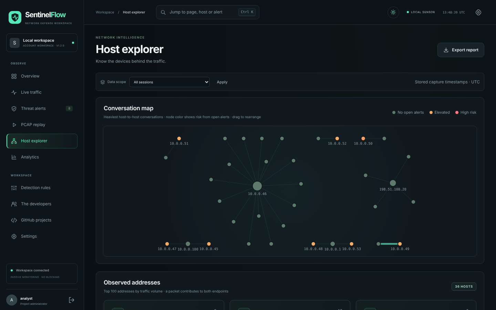 | 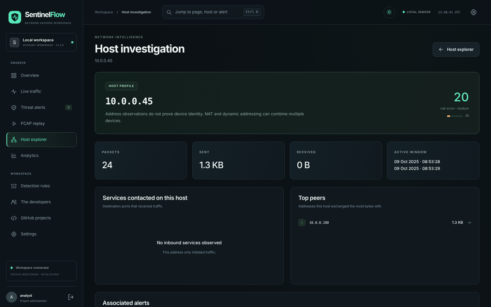 |
| **Analytics and ATT&CK tactics** | **Light appearance** |
| 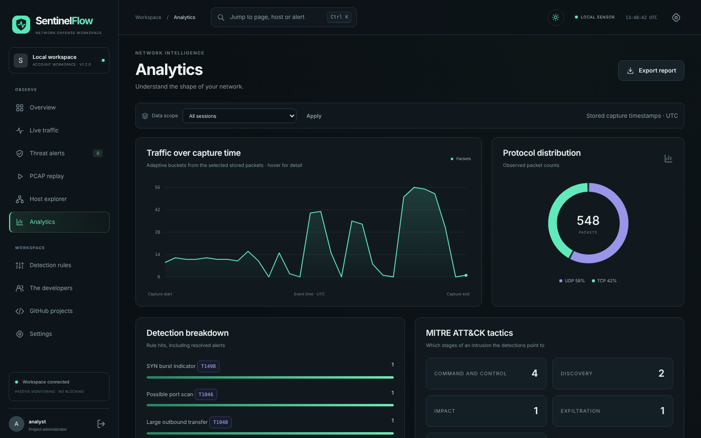 | 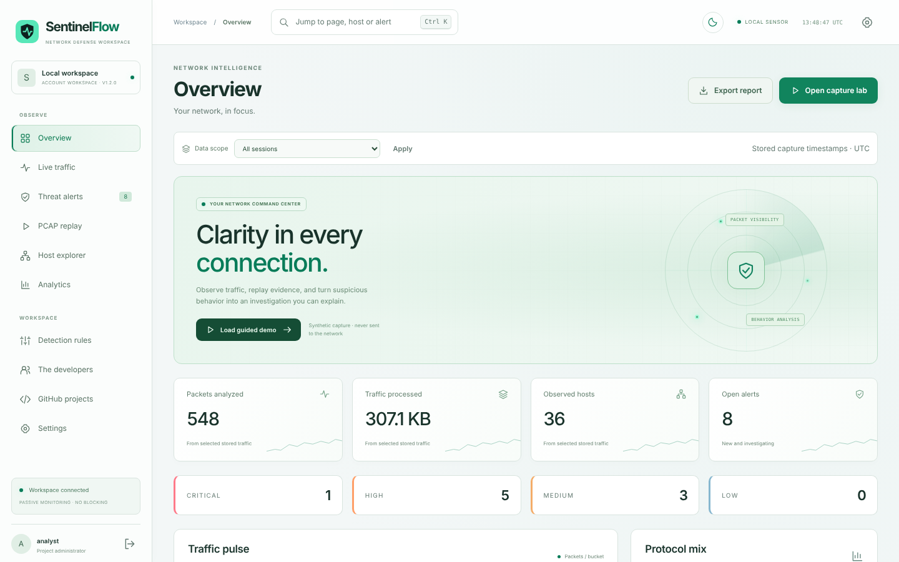 |
| **Command palette** | **Detection rules** |
| 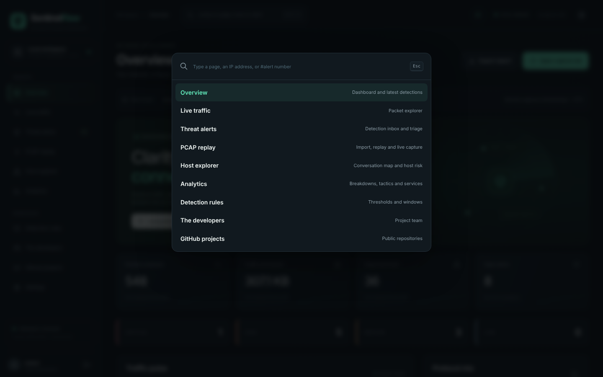 | 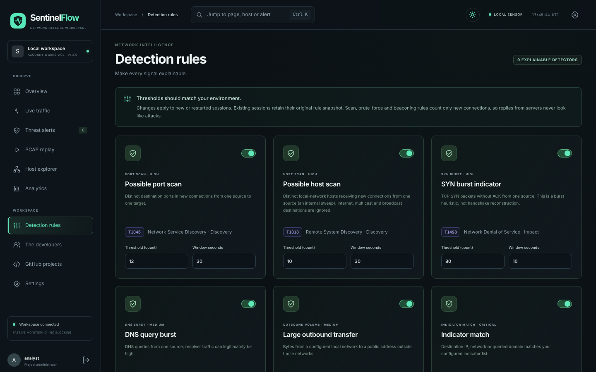 |

<p align="center">
  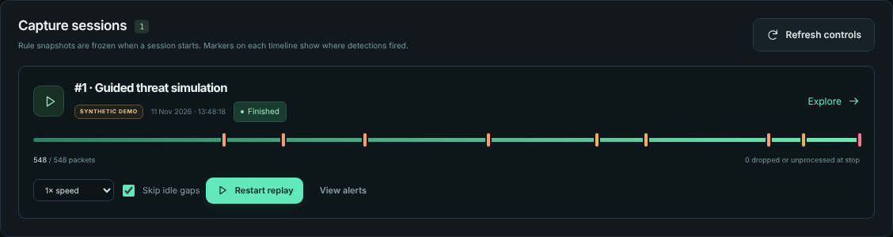
  <br><sub>Replay sessions show where each detection fired on the capture timeline.</sub>
</p>

<details>
<summary>Sign-in and mobile layout</summary>
<br>
<p align="center">
  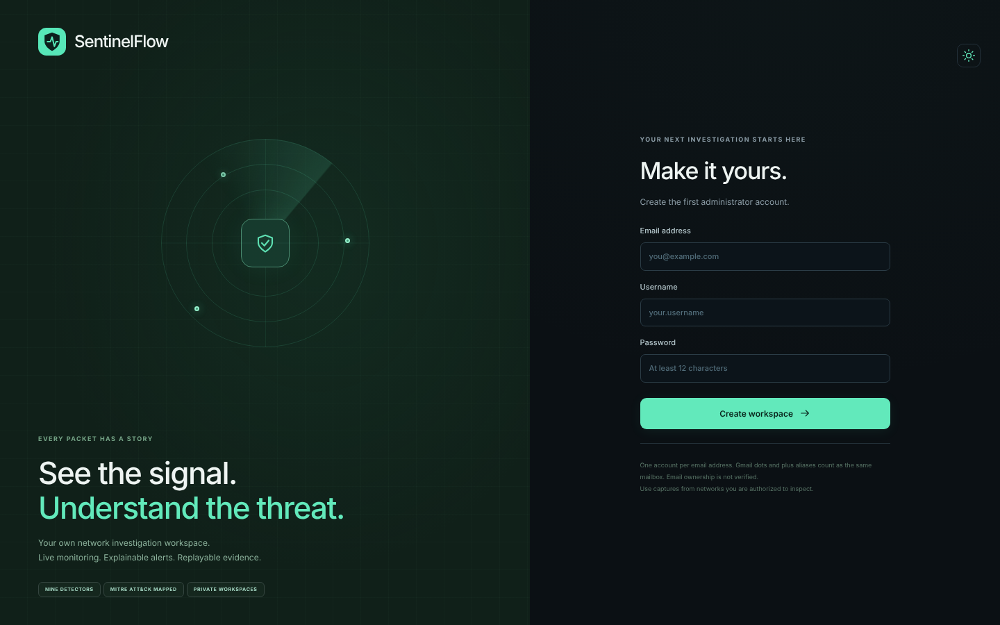
  &nbsp;
  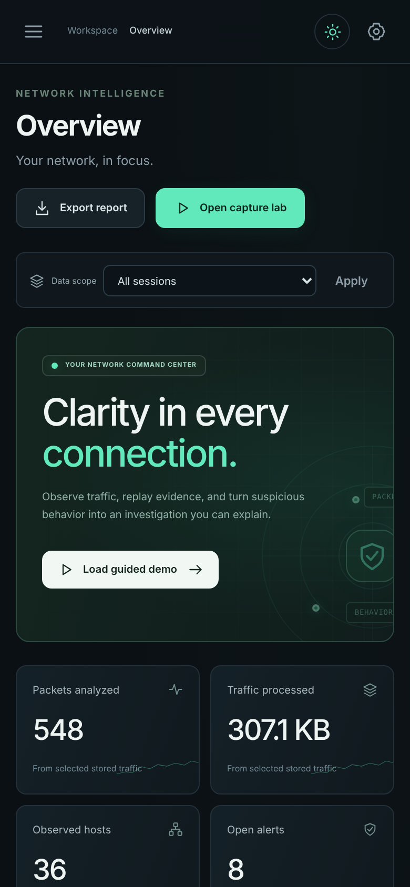
</p>
</details>

## Quick start

**Requirements:** Python 3.11 or newer. You don't need packet-capture privileges for PCAP replay.

### Linux or macOS

```bash
git clone https://github.com/MeazbahMehedi/SentinelFlow.git
cd SentinelFlow
python3 -m venv .venv
.venv/bin/python -m pip install -r requirements.txt
.venv/bin/python run.py
```

Or run `bash start_unix.sh`, which does the same.

### Windows

```powershell
git clone https://github.com/MeazbahMehedi/SentinelFlow.git
cd SentinelFlow
py -3 -m venv .venv
.\.venv\Scripts\python.exe -m pip install -r requirements.txt
.\.venv\Scripts\python.exe run.py
```

Or double-click `start_windows.bat`.

### Docker

```bash
docker build -t sentinelflow .
docker run --rm -p 5000:5000 -v sentinelflow-data:/data sentinelflow
```

The container is intended for PCAP replay and analysis. Live capture inside a container also needs host networking and the `NET_RAW` and `NET_ADMIN` capabilities.

Open **http://127.0.0.1:5000** and create the first administrator account. There are no default credentials. Other people can then use **Create your account** on the sign-in page.

### Your first investigation

1. On **Overview**, choose **Load guided demo**. This loads a synthetic 548-packet capture that triggers every detector once and is never sent to the network.
2. In **PCAP replay**, start the session at 8×. The dashboard, timeline and alert counter update as the replay runs.
3. Open **Threat alerts**, select the beaconing alert, and review its evidence: check-in interval, jitter and ATT&CK technique.
4. Open **Host explorer** to see the conversation map, then open a high-risk host's profile.
5. Mark alerts **Investigating**, **Resolved** or **False positive**, either one at a time with notes or in bulk.

## Detection engine

Detectors run on **capture time**, not wall-clock time, so a replay at 32× produces exactly the same alerts as one at 1×. Each rule counts observations in a sliding window keyed by the entities involved. After a rule fires, it is suppressed for one window per key. When a session starts, it freezes a snapshot of the rules and settings in use.

| Rule | Default threshold | What it counts | ATT&CK |
|---|---|---|---|
| `port_scan` | 12 ports / 30 s | Distinct destination ports in **new** connections from one source to one target | T1046 Network Service Discovery |
| `host_scan` | 10 hosts / 30 s | Distinct **local-network** hosts receiving new connections from one source | T1018 Remote System Discovery |
| `syn_burst` | 80 / 10 s | TCP SYN without ACK from one source | T1498 Network Denial of Service |
| `dns_burst` | 60 / 30 s | DNS queries (not responses) from one source | T1071.004 DNS |
| `dns_tunneling` | 10 / 60 s | Long or high-entropy query names under one domain | T1071.004 DNS |
| `brute_force` | 20 / 60 s | New connections to one authentication service (SSH, RDP, SMB, FTP, databases, VNC, WinRM) | T1110 Brute Force |
| `beaconing` | 8 / 600 s | Connections to one service at regular intervals (≥ 1 s mean, ≤ 15 % jitter) | T1071 Application Layer Protocol |
| `outbound_volume` | 250 KB / 60 s | Bytes from a local network to a public address | T1048 Exfiltration Over Alternative Protocol |
| `indicator_match` | 1 / 60 s | Destination IP or CIDR, or queried domain, on your indicator list | T1071 Application Layer Protocol |

**Flow tracking.** A bounded LRU table of bidirectional flows decides whether each packet opens a connection. TCP flows open only on SYN without ACK. UDP and other protocols open on the first packet seen for a 5-tuple. The scan, brute-force and beaconing rules count only flow openers. This prevents a web server answering many client connections from being reported as a port scan.

**Address handling.** Multicast, broadcast (including each local network's directed broadcast), loopback and link-local destinations are excluded from the scan and exfiltration rules. The defaults include IPv6 unique-local addresses (`fc00::/7`).

**Evidence.** Every alert stores the observed value, threshold, window, rule-specific details (beacon interval and jitter, DNS entropy and label length, matched indicator), and the packets from the trigger window.

Thresholds, windows and indicators can be edited in **Detection rules** and **Settings**.

## Architecture

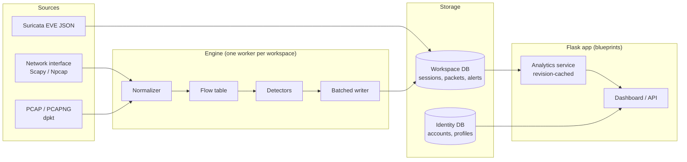

- **Engine.** Normalized events pass through the flow table and detectors and are written in batches of up to 250 packets, or every 250 ms. The retained-packet count is kept in memory, so ingestion speed doesn't fall as the database grows.
- **Dashboard updates.** Each workspace keeps a revision counter that advances on every committed write. The browser polls `/api/snapshot?rev=N`, which returns `204 No Content` when nothing has changed. Summaries are cached per revision, so any number of open tabs share one computation and none of them holds a server thread open.
- **Isolation.** Every account has its own workspace database and engine. Only one live capture can run on the host at a time.

### Project structure

```text
sentinelflow/
├── __init__.py          Application factory
├── services.py          Identity store, per-account workspaces and engines
├── db.py                SQLite schema, migrations, revision tracking
├── engine.py            Replay and live-capture workers, batched writer
├── flows.py             Bidirectional flow table
├── detection.py         Detectors, MITRE ATT&CK mapping
├── analytics.py         Dashboard, explorer and graph queries with caching
├── packets.py           PCAP/PCAPNG parsing and the synthetic demo capture
├── capture.py           Cross-platform capture diagnostics (Npcap on Windows)
├── integrations.py      Suricata EVE import
├── security.py          Login throttling and timing-safe password checks
├── accounts.py          Email normalization
├── github.py            Cached, read-only GitHub profile and repository data
├── web/                 Blueprints: auth, pages, capture lab, alerts, admin, api, exports
├── templates/           Jinja templates
└── static/              CSS, JavaScript and icons (no build step)
scripts/                 Evaluation, sample generation, browser check, screenshots
samples/                 Synthetic PCAPs and an example EVE file
tests/                   pytest suite
```

## Live capture

As an administrator, open **PCAP replay → Connect your sensor**, check that the capture backend is ready, choose an interface, and start monitoring.

- **Windows:** install [Npcap](https://npcap.com/#download), then close and reopen your terminal. If Npcap was installed with administrator-only access, start SentinelFlow from an elevated terminal. Running `python scripts/check_capture.py` prints diagnostic details.
- **Linux:** capturing needs raw-socket permission, for example `sudo setcap cap_net_raw,cap_net_admin=eip "$(readlink -f .venv/bin/python)"`, or running in a controlled environment.
- **macOS:** your user needs access to the `/dev/bpf*` devices.

A sensor sees only the traffic that reaches its interface. On a switched network, monitoring other devices needs a mirror (SPAN) port or a tap. SentinelFlow is passive: it never blocks or alters traffic, and it doesn't decrypt payloads.

## Configuration

| Variable | Default | Purpose |
|---|---|---|
| `HOST` | `127.0.0.1` | Bind address. Change it only on a trusted network |
| `PORT` | `5000` | HTTP port |
| `TRUSTED_HOSTS` | `localhost,127.0.0.1,[::1]` | Accepted `Host` header values. Add your LAN IP when serving to other devices |
| `SENTINELFLOW_DATA` | `./instance` | Runtime data directory |
| `SECRET_KEY` | generated | Session signing key. A private key file is created on first run if this is unset |
| `COOKIE_SECURE` | unset | Set to `1` only when serving over HTTPS |

| Limit | Value |
|---|---|
| Imported capture | 32 MiB, 50,000 packets |
| Sessions per workspace | 100 |
| Retained packets per workspace | 100,000 (configurable from 1,000 to 500,000) |
| Live capture queue | 20,000 events |
| Session lifetime | 8 hours |
| Failed sign-ins | 20 per address per 5 minutes; 8 per account per 15 minutes |

Runtime data lives under `instance/`, which is excluded from Git:

```text
instance/
├── sentinelflow.db              Accounts and developer profiles
├── workspaces/primary/          The first (owner) account's workspace
├── workspaces/<user-id>/        Every other account's workspace
├── media/                       Developer photos and CVs
└── github-cache/                Cached public GitHub data
```

## Testing and quality

```bash
python -m pip install -r requirements-dev.txt
python -m pytest -q                 # 161 tests
python scripts/evaluate.py          # detector coverage on bundled fixtures
ruff check . && ruff format --check .
python -m playwright install chromium
python scripts/browser_check.py     # end-to-end check against the real launcher
```

The test suite covers every detector, plus regression tests for the false positives fixed in 1.2 (server replies, mid-stream traffic, internet browsing, multicast). It also covers:

- replay determinism across speeds
- batched ingestion and retention limits
- the snapshot revision cache
- login throttling and session revocation
- workspace isolation
- migration of data from 1.x installs

The browser check drives the actual Waitress launcher. It covers account creation, demo replay, all ten pages in both themes at desktop and phone widths, the command palette, alert triage, and a clean shutdown on Ctrl+C.

GitHub Actions runs lint, the test suite on Python 3.11 to 3.14, a JavaScript syntax check, and the browser check.

`python scripts/capture_screenshots.py` regenerates the images in this README from the synthetic demo.

## Upgrading from 1.x

Stop the old server, back up `instance/`, then start the new version against the same data directory. On the first start, SentinelFlow 1.2:

- moves the first account's sessions, packets, alerts, notes and audit trail out of the identity database into `instance/workspaces/primary/`, in a single transaction that can resume if interrupted
- adds the three new detectors to your saved rules without changing the thresholds you set
- leaves existing accounts, roles and profiles as they are

## Security

SentinelFlow is a local investigation tool, and by default it listens only on `127.0.0.1`. See [SECURITY.md](SECURITY.md) for the protections it implements and its operational boundaries. Only analyze traffic from networks you are authorized to monitor.

## Limitations and roadmap

The detectors are heuristics, and their thresholds need tuning for each environment. The bundled fixtures demonstrate coverage but say nothing about real-world precision or recall. SentinelFlow doesn't reassemble TCP streams, inspect payloads beyond DNS query names, decrypt TLS, or block traffic.

Planned next steps:

- an evaluation against labelled public datasets (CIC-IDS2017, UNSW-NB15)
- TLS SNI and JA4 fingerprints
- Zeek log ingestion
- learned per-host baselines
- a PCAP slice export for each alert

## Developers

Built by [MeazbahMehedi](https://github.com/MeazbahMehedi) and [ItsMONIKAAKTER](https://github.com/ItsMONIKAAKTER). See [CONTRIBUTING.md](CONTRIBUTING.md) to contribute.

## License

[MIT](LICENSE)
