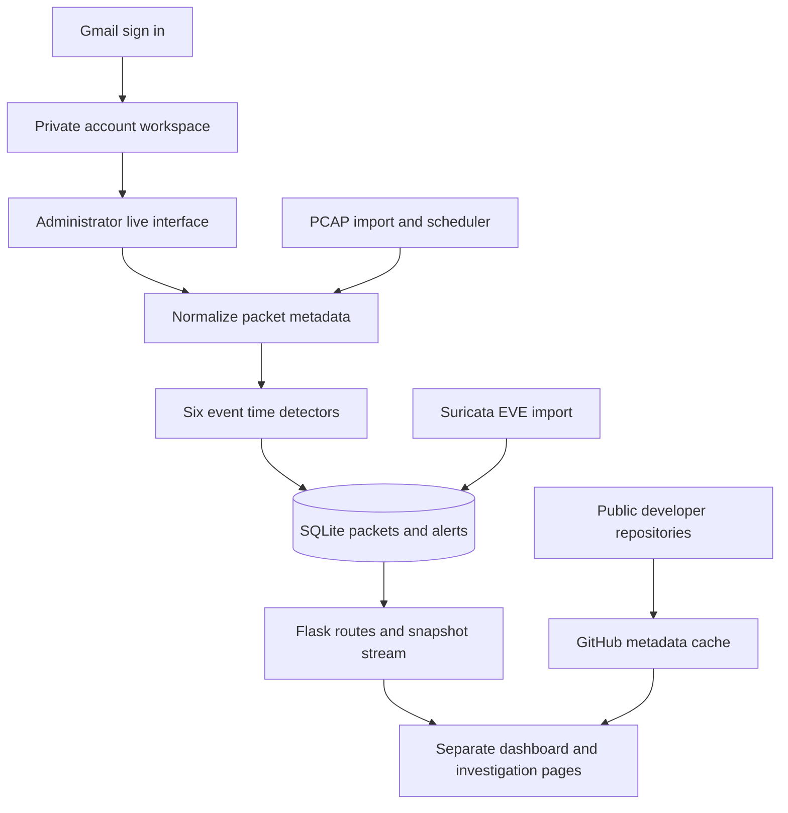

<div align="center">
  
  <h1>SentinelFlow</h1>
  <p><strong>Real-Time Network Threat Detection with a Live Dashboard and PCAP Replay</strong></p>
  <p>Inspect traffic. Understand the evidence. Replay the investigation.</p>
  <p>Python · Flask · SQLite · dpkt · Scapy · Multi-account · Dark and light themes</p>
</div>

---

SentinelFlow is a Python network security investigation application with **ten separate navigation pages**, an animated dashboard, deterministic PCAP replay, six explainable behavioral detectors, and Suricata EVE alert imports. It turns packet metadata into persistent alerts that an analyst can inspect, annotate, and export.

It is designed for software engineering coursework, network security demonstrations, and a readable GitHub portfolio. It runs locally without API keys, a JavaScript build pipeline, or a GPU. The GitHub Projects page reads public repository metadata when internet access is available; network captures stay in the local workspace.

> **Project status:** functional educational application. The automated suite and browser checks are described in [VALIDATION.md](docs/VALIDATION.md). This is a passive detection tool; it does not block traffic or guarantee that every attack will be detected.

## Contents

- [What is included](#what-is-included)
- [Quick start](#quick-start)
- [Upgrade from version 1.0](#upgrade-from-version-10)
- [Accounts and permissions](#accounts-and-permissions)
- [Dark and light appearance](#dark-and-light-appearance)
- [GitHub projects](#github-projects)
- [First demonstration](#first-demonstration)
- [Live capture](#live-capture)
- [Detection rules](#detection-rules)
- [Replay behavior](#replay-behavior)
- [Suricata integration](#suricata-integration)
- [Developer profiles](#developer-profiles)
- [Architecture](#architecture)
- [Project structure](#project-structure)
- [Testing and evaluation](#testing-and-evaluation)
- [Configuration and data](#configuration-and-data)
- [Troubleshooting](#troubleshooting)
- [Publishing on GitHub](#publishing-on-github)
- [Limitations and next steps](#limitations-and-next-steps)

## What is included

| Area | Implemented behavior |
|---|---|
| Multi-page interface | Overview, Live Traffic, Threat Alerts, PCAP Replay, Host Explorer, Analytics, Detection Rules, Developers, GitHub Projects, Settings |
| Appearance | Full dark/light themes, system preference on first visit, saved browser preference, theme-aware charts |
| Multiple accounts | Gmail-based registration, canonical mailbox uniqueness, private capture workspaces, administrator and analyst roles |
| GitHub Projects | GitHub-sourced profiles and photos for two fixed accounts, multiple public repositories, search, language/type filters, stars, forks, update dates, cache/offline states |
| Animated UI | Radar sweep, pulsing sensor points, animated page entry, progress bars, hover states, responsive layouts, reduced-motion support |
| Live updates | Server-Sent Events for counters, charts, connection status, session progress, and detection notifications; traffic rows update by polling |
| PCAP support | Ethernet, raw IP, loopback, Linux cooked capture; classic PCAP and single-interface PCAPNG; IPv4 and IPv6 metadata |
| Replay | Start, pause, resume, stop, restart, and speeds from 0.25× to 32× |
| Detection | Port scans, host scans, SYN bursts, DNS query bursts, outbound-volume thresholds, destination IP indicators |
| Alert investigation | Trigger values, rule thresholds, capture timestamps, packet context, related signals, notes, four triage states |
| Hosts and analytics | Address activity, directional connection counts, protocol mix, capture-time plots, top talkers, rule breakdown |
| Suricata | Import existing EVE JSON signature alerts into the same triage workflow |
| Profiles | Two editable developer profiles, biographies, roles, skills, links, profile photos, and downloadable PDF CVs |
| Local security | Account creation, unique Gmail index, password hashing, CSRF protection, login throttling, per-account data isolation, role checks, security headers, authenticated media routes |
| Reporting | CSV packet exports, CSV alert exports, JSON summaries, configuration activity log |
| Documentation | Complete Word SRS, architecture diagrams and editable DOT sources, validation record, contribution and security guidance |

## Quick start

### Requirements

- Python **3.11 or newer**; this release was executed on Python 3.12.
- A current desktop browser.
- Internet access for the initial dependency installation.
- No packet-capture privileges are needed for PCAP replay.

### Windows

The user-reported Python 3.14 setup uses the updated Scapy 2.8.0 dependency in this release. Windows capture additionally requires Npcap; `pip install scapy` does not install that OS driver.

Extract the ZIP, open a terminal in the project directory, and run:

```powershell
py -3 -m venv .venv
.\.venv\Scripts\python.exe -m pip install -r requirements.txt
.\.venv\Scripts\python.exe run.py
```

Alternatively, double-click **start_windows.bat**. It creates the virtual environment, installs dependencies, and starts the application. If the Python launcher `py` is unavailable, use `python` in the first command.

### Linux or macOS

```bash
python3 -m venv .venv
.venv/bin/python -m pip install -r requirements.txt
.venv/bin/python run.py
```

Or run `bash start_unix.sh`.

Open **http://127.0.0.1:5000** and create the first administrator account with your Gmail address. Later users choose **Create your account** on the sign-in page. Passwords must contain 12–128 characters. There is no preconfigured username or password.

The initial installation resolves compatible dependency versions. [requirements-lock.txt](requirements-lock.txt) records the exact application dependency versions used for release verification.

## Upgrade from version 1.0

1. Stop the old server and back up its **instance** folder.
2. Extract this release to a new folder. To keep your original account, captures, notes, profiles, photos, and CVs, copy the old **instance** folder into the new project root before starting.
3. Create a fresh virtual environment and install this release's requirements. Do not copy `.venv`, `.idea`, or `__pycache__` into the new project or onto GitHub.
4. Start `python run.py`. The additive migration preserves your first account as administrator and keeps its existing data.
5. If the old account has no email, sign in with the existing username and link its Gmail once in **Settings** using the current password.
6. New users can register separately. Their captures, alerts, notes, exports, rules, and settings use separate databases.

## Accounts and permissions

Registration accepts consumer Gmail addresses. The stored key is lowercase, uses `gmail.com`, removes dots from the mailbox name, and ignores `+tags`. For example, `student.name@gmail.com` and `studentname+class@gmail.com` cannot create two accounts. A database unique index enforces the rule even for simultaneous registration attempts.

**Email ownership is not verified.** This is Gmail-format validation and mailbox uniqueness, not Google Sign-In, a verification email, or proof that the person owns the address. A real public deployment should add email verification or Google OAuth and an appropriate account recovery flow.

| Capability | Analyst | Administrator |
|---|---|---|
| Own PCAP/EVE imports, replay, investigations, rules, exports | Yes, private to the account | Yes, private to the account |
| View developer profiles and public GitHub projects | Yes | Yes |
| Capture the host machine's live traffic | No | Yes, subject to OS capture permissions |
| Edit shared project developer profiles and CVs | No | Yes |
| Promote another user to administrator or analyst | No | Yes, in Settings |

Administrators do not get a UI endpoint for reading another user's private capture database. Live capture still observes the shared host interface, so grant administrator access only to people who should have that capability. Your own administrator role cannot be removed through its account-permission control.

## Dark and light appearance

Use the sun/moon button in the top bar or sign-in screen. Both themes cover the dashboard, charts, forms, alerts, replay controls, developer profiles, and GitHub page. The first visit follows your OS preference. Your selection is saved in that browser and applied before page paint to avoid a theme flash. Motion respects `prefers-reduced-motion`.

## GitHub projects

Release 1.1.1 adds fixed GitHub profile cards. See the [specification supplement](docs/GITHUB_PROFILE_UPDATE.md) alongside the bundled release 1.1 Word SRS.

The dedicated **GitHub Projects** navigation page displays public repositories from:

- [MeazbahMehedi](https://github.com/MeazbahMehedi)
- [ItsMONIKAAKTER](https://github.com/ItsMONIKAAKTER)

Each developer card loads the public **GitHub avatar, display name, bio, location, company, HTTPS website, account creation date, follower/following counts, and public-repository count** when supplied by GitHub. Missing fields are omitted or honestly labeled. Broken or unavailable images fall back to the account initial.

The accounts are fixed in `sentinelflow/github.py` as **MeazbahMehedi** and **ItsMONIKAAKTER**. They cannot be changed through website settings, profile forms, or API writes. The separate editable Developers/CV page does not control these GitHub cards. To change the cards’ public information, update the corresponding profile on GitHub.

All returned public repositories are listed (up to 1,000 per account, explicitly labeled if capped), including multiple projects and forks. The service follows API pagination in batches of 100. It shows repository descriptions, primary language, stars, fork counts, topics, and update dates, with keyword, language, and original/fork filters. A user with no public repositories gets an honest empty state. Private repositories are not requested.

Profile and repository requests have independent caches and failure states, so one unavailable endpoint does not hide the other’s data. Avatars load only from `avatars.githubusercontent.com`; no local photo override is used on this page.

Public API results are shared across accounts, cached for five minutes, and refreshed while the page is visible. Manual Refresh also respects the cache and GitHub rate limits. Offline or rate-limited data is explicitly labeled; counts are never generated to imitate a successful fetch. The integration is read-only and never publishes code or sends captures to GitHub.

## First demonstration

1. Open **Overview** and click **Load guided demo**.
2. In **PCAP Replay**, choose **4×**, **8×**, or **32×** and click **Start replay**.
3. The bundled historical capture contains **501 synthetic packets** spanning 29 capture-time seconds.
4. With the default rules, the completed replay produces **six alerts**, one from each detector.
5. Open **Threat Alerts**, choose an alert, inspect its observed value and threshold, and review the packet context.
6. Change its status to **Investigating**, add your reasoning, and save.
7. Explore **Host Explorer** and **Analytics**, then export CSV or JSON results.
8. Open **The Developers** to customize the two project authors.

All demonstration packets are generated as files using private/documentation addresses. The generator and replay engine **never transmit them**. Their timestamps intentionally remain historical rather than pretending to be new live traffic.

Three ready-to-use fixtures are included:

| File | Purpose | Default expected result |
|---|---|---|
| `samples/guided-threats.pcap` | Six isolated suspicious behavior scenarios | 501 packets and 6 alerts |
| `samples/normal-traffic.pcap` | Simple ordinary traffic fixture | 60 packets and 0 alerts |
| `samples/example-eve.json` | Suricata import example, explicitly synthetic | 1 imported alert |

Regenerate them with `python scripts/generate_samples.py`.

## Live capture

As an administrator, open **PCAP Replay → Connect your sensor**, check backend readiness, select the friendly interface name, and start monitoring. The application records packet metadata visible to that interface.

- **Windows:** install [Npcap](https://npcap.com/#download), then completely close and restart Python. Scapy recommends keeping WinPcap compatibility mode disabled. If Npcap was installed with administrator-only capture access, reopen PowerShell as Administrator before starting this project. The app adds the Npcap DLL directory before initializing Scapy and requests its pcap backend.
- **Linux:** packet capture requires the appropriate OS permissions. Use a controlled environment and the minimum permissions appropriate for your machine. Replay remains available without these permissions.
- **macOS:** access to BPF capture devices depends on the machine's capture configuration.

The live panel shows backend readiness, a **Recheck** action, friendly adapter names, and platform-specific recovery guidance. It disables Start when the backend is missing. One active live or replay session is allowed **per account**. Live monitoring can be stopped; pause/resume applies to replay only.

A sensor cannot see every device on a switched network just because it is connected to Wi-Fi or Ethernet. Visibility depends on interface placement, mirroring, and the host OS. Encrypted payloads are not decrypted.

### Fix the reported WinPcap error

The message `Sniffing and sending packets is not available at layer 2: winpcap is not installed` means the capture backend is missing or unavailable to that Python process. Installing a Python package alone cannot supply the Windows driver.

1. Install or repair Npcap from its official site.
2. Close the running server and terminal completely after installation.
3. Reopen a terminal, elevated if Npcap capture is restricted to administrators.
4. Install the updated requirements and run the server again.
5. Use **Recheck** and select the adapter actually carrying your traffic.
6. If needed, run `python scripts/check_capture.py` to print diagnostic details.

The application does not silently substitute an L3 sending socket for passive capture. PCAP replay remains usable without the driver. Physical Windows capture still requires verification on the target PC; driver-missing, adapter-selection, permission-error, and loopback normalization paths are covered by tests.

### Stop the server

Press **Ctrl+C once**. The launcher cooperatively stops monitoring, wakes SSE connections, closes HTTP workers, and prints `SentinelFlow stopped cleanly.` Repeated Ctrl+C during cleanup is handled without interrupting Waitress's internal shutdown waits. The browser shutdown check exercises this with a paused replay and an active event stream.

## Detection rules

Rules use packet capture timestamps, not dashboard wall-clock time. Thresholds and windows are editable in **Detection Rules**.

| Rule | Default threshold | Window | Detection key | Severity |
|---|---:|---:|---|---|
| Possible port scan | 12 distinct destination ports | 30 s | Source + destination | High |
| Possible host scan | 10 distinct destination IPs | 30 s | Source | High |
| SYN burst indicator | 80 SYN packets without ACK | 10 s | Source | High |
| DNS query burst | 60 decoded UDP DNS queries | 30 s | Source | Medium |
| Large outbound transfer | 250,000 captured bytes | 60 s | Local source | Medium |
| Destination indicator match | 1 matching packet | 60 s | Source + destination | Critical |

Each detector suppresses repeat alerts for the same detection key for one rule-window duration after firing. A session snapshots its rule configuration and local network definitions when started. Saving new rules does not silently change an active investigation.

Outbound volume counts captured frame bytes from a configured local network to an address outside those networks. It is a configured threshold, not a learned baseline. The SYN detector measures bursts; it does not reconstruct full TCP handshakes. DNS inspection covers decoded UDP DNS, not DNS over HTTPS or TLS. Indicator matching is exact IP matching against your list; there is no live reputation feed.

## Replay behavior

- PCAP import validates the capture, normalizes supported packet metadata, sorts by event timestamp, and stores replay events.
- Replay waits according to the original inter-packet timing divided by the selected speed.
- Pause preserves the remaining scheduling delay. Stop leaves the processed portion available for investigation.
- Restart deletes that session's previous packets, alerts, triage notes, and progress, then rebuilds results from the stored events. A confirmation is displayed.
- An application restart marks previously running/paused sessions **Interrupted**. They can be restarted; they are not silently resumed with incomplete detector state.
- Non-IP or undecodable frames are skipped. Multi-interface or multi-section PCAPNG is rejected rather than interpreted using the wrong link type.
- Live packets arriving out of timestamp order remain visible in traffic but do not alter the detector's already advanced window clock.

## Suricata integration

If you already use [Suricata](https://suricata.io/), import a newline-delimited **EVE JSON** file through **PCAP Replay → Import Suricata alerts**.

The importer accepts alert events with timezone-aware timestamps, valid source/destination IPs, and signature details. Non-alert events are ignored. EVE severities 1, 2, and 3 map to High, Medium, and Low.

An EVE import creates an alert-only session. It does not run Suricata, replay packets, install rules, or reconstruct packet evidence from logs. Imported alerts retain their signature identifier in their evidence JSON. `samples/example-eve.json` demonstrates the accepted structure.

## Developer profiles

An administrator can use **The Developers → Edit profile** for each author. Other users can view these shared project profiles. You can add:

- Full name and role/contribution.
- Biography and comma-separated skills.
- Email, GitHub, LinkedIn, and portfolio URLs.
- A photo, re-encoded as a local PNG.
- A PDF CV served as a download.

Photos and CVs are limited to 5 MiB each. Photos are limited to 20 megapixels. PDF uploads receive file-envelope checks, not antivirus scanning. Profile files are private to the authenticated workspace.

The application starts with two editable placeholders and the supplied GitHub profile links. It does not invent author names, qualifications, contact information, or CV content.

## Architecture



The frontend uses server-rendered Jinja pages with local CSS, SVG assets, and JavaScript. Charts are rendered with Canvas. There is no React dependency or Node installation requirement for running the application.

Offline parsing uses **dpkt**, which opens no capture socket. **Scapy is imported only for live capture**, so a machine with restricted capture permissions can still run the dashboard and replay workflow.

SQLite uses WAL mode, foreign keys, parameterized queries, and a connection per operation. The local launcher uses **one Waitress process with 24 HTTP threads** and a workspace-specific background engine worker for each active account. Do not deploy multiple WSGI processes against the same data directory: worker coordination is intentionally process-local. The shared identity database authenticates users; a scoped workspace resolver selects only the signed-in account’s data store and engine. A browser page holds one SSE connection; this is a small local workspace, not a large multi-user service.

Detailed architecture, data flow, deployment, state, and database diagrams are in [docs/diagrams](docs/diagrams), with the complete [Word SRS](docs/SentinelFlow_SRS.docx).

## Project structure

```text
sentinelflow/
├── run.py                    # Local threaded launcher and clean shutdown
├── start_windows.bat         # Windows setup and startup
├── start_unix.sh             # Linux/macOS setup and startup
├── requirements.txt          # Supported application dependencies
├── requirements-lock.txt     # Exact release verification versions
├── requirements-dev.txt      # Test dependencies
├── sentinelflow/
│   ├── __init__.py           # Flask factory, routes, auth, forms, exports
│   ├── db.py                 # SQLite schema and persistence
│   ├── accounts.py           # Gmail canonicalization
│   ├── capture.py            # Npcap/OS readiness and interface handling
│   ├── github.py             # Read-only public repositories and cache
│   ├── detection.py          # Six event-time rules
│   ├── engine.py             # Replay scheduler and live worker
│   ├── packets.py            # Capture normalization and safe fixtures
│   ├── integrations.py       # Suricata EVE import
│   ├── templates/            # Separate Jinja pages
│   └── static/               # Local CSS, JavaScript, SVG icons
├── samples/                  # Synthetic PCAP and EVE fixtures
├── scripts/                  # Sample generation and coverage evaluation
├── tests/                    # Detector, parser, engine, web, integration tests
├── docs/                     # SRS, diagrams, validation and demo guidance
└── .github/workflows/        # Python test workflow
```

## Testing and evaluation

```bash
python -m pip install -r requirements-dev.txt
python -m pytest -q
python scripts/evaluate.py
```

The tests additionally verify Gmail alias uniqueness, account isolation, role changes, legacy migration, GitHub cache/offline behavior, and capture diagnostics. They also cover rule thresholds, window expiry, duplicate suppression, IPv6, PCAPNG, malformed captures, replay-speed invariance, pause/resume/stop, session restart, frozen rules, persistence, auth, CSRF, uploads, exports, alert triage, EVE imports, and cascade deletion.

`evaluate.py` reports deterministic coverage on the bundled synthetic fixtures. Six covered scenarios and zero alerts on one normal fixture do **not** establish real-world precision, recall, or production detection accuracy.

A GitHub Actions workflow is supplied for Python 3.11, 3.12, 3.13, and 3.14. It has not been run in your GitHub account; its results will appear after you publish the repository.

## Configuration and data

| Item | Default |
|---|---|
| Address | `127.0.0.1:5000` by default; optional explicit LAN configuration |
| Runtime data | `instance/` in the launch directory |
| Imported capture size | 32 MiB |
| Supported packets per import | 50,000 total capture records, including skipped frames |
| EVE import | 32 MiB, 50,000 lines, maximum 1 MB per line |
| Stored sessions | Up to 100 per account |
| Retained analyzed packets | 100,000 per account; configurable from 1,000 to 500,000 |
| Live queue | 5,000 events |
| Session lifetime | 8 hours |
| Login attempts | 10 attempts per remote address per 5-minute window |

Environment variables:

- `PORT`: HTTP port, for example `5001`.
- `HOST`: bind address, default `127.0.0.1`.
- `TRUSTED_HOSTS`: comma-separated accepted request hostnames/IPs, default `localhost,127.0.0.1,[::1]`.
- `SENTINELFLOW_DATA`: alternative runtime data directory.
- `SECRET_KEY`: optional persistent session-signing secret. Otherwise, the application generates a private local key file.
- `COOKIE_SECURE=1`: only when serving through a correctly configured HTTPS environment. The default local HTTP launcher should leave this unset.

Use **Settings** to configure local CIDR ranges, IP indicators, retention limits, and your account password. Delete an old session to reclaim logical packet capacity. SQLite may reuse deleted space without reducing the database file size immediately.

Runtime data, credentials, photos, and CVs live under `instance/`, which is excluded by `.gitignore`. The original first account retains its legacy database at `instance/sentinelflow.db`; additional account workspaces use `instance/workspaces/<user-id>/workspace.db`. User identities and shared developer profiles remain in the main database. Public repository cache files live in `instance/github-cache/`. Temporary imported source files are deleted after parsing; normalized replay metadata remains until the session is deleted. No raw packet payload is stored in the application database.

## Troubleshooting

| Symptom | Action |
|---|---|
| `python` or `py` is not found | Install Python 3.11+ and reopen the terminal; enable its PATH option if needed |
| `No module named flask` or `dpkt` | Install requirements using the same virtual-environment Python used to run the app |
| Port 5000 is occupied | Set `PORT=5001` using your shell's environment syntax and open that port |
| Live capture cannot start | Check interface selection, Npcap/OS capture permissions; use PCAP replay meanwhile |
| No other devices are visible | Check sensor placement and interface visibility; ordinary switched networks do not expose all traffic |
| A PCAP import is rejected | Check file size, record count, supported link type, and single-interface PCAPNG constraints |
| Replay says another session is active | Stop the current replay/live session in your account before starting another |
| Rules were changed but an active session looks unchanged | Rule snapshots are intentionally frozen; restart or start a new session |
| Demo timestamps are in the past | They are original capture timestamps; the dashboard clock shows current UTC separately |
| Replay controls look stale | Status/progress update live; use **Refresh controls** if a navigation or connection interruption occurred |
| Packet limit was reached | Delete an older session in Settings or increase the configured retained-packet ceiling |
| Browser says a form expired | Refresh and submit again so the CSRF token matches your current login session |
| Forgot your local password | Stop the app, back up `instance/`, and use a fresh `SENTINELFLOW_DATA` directory to create a new workspace; no insecure recovery backdoor is included |

## Optional access from another device on your local network

Accounts work on the local host by default. To let another device on a trusted LAN open the application, explicitly configure the bind address and your computer's actual LAN IP. For example in PowerShell, replacing the sample IP with yours:

```powershell
$env:HOST = "0.0.0.0"
$env:TRUSTED_HOSTS = "localhost,127.0.0.1,192.168.1.25"
python run.py
```

The other device opens `http://192.168.1.25:5000`, subject to your firewall rules. Set up the first administrator before enabling LAN access. This is not a public internet deployment configuration; use TLS, verified email, and appropriate deployment hardening for a public service.

## Publishing on GitHub

1. Extract the project and run the test suite. The README tree deliberately excludes your large `.venv` dependency tree and IDE cache folders.
2. Replace the two developer placeholders through the UI for your local demonstration.
3. Update this README with your names, university details if desired, and the repository URL.
4. Check `.gitignore` before staging. Do not commit `instance/`, real traffic captures, CVs, credentials, or your virtual environment.
5. Initialize your repository and publish it using GitHub's standard workflow.
6. Keep the included synthetic samples; they let a reviewer reproduce the demonstration safely.
7. Add your own screenshots later if you want a visual project gallery.

The local profile editor stores data in the database. Those edits intentionally do not modify this README or become public GitHub author information automatically.

## Limitations and next steps

Implemented scope is behavioral network monitoring with external signature-alert import. This release does not include machine learning, Zeek ingestion, distributed sensors, TCP stream reassembly, payload deep inspection, network blocking, automated response, email notifications, or a public internet deployment configuration.

Potential extensions are a labeled evaluation corpus, an evaluated anomaly baseline, Zeek logs, full flow reconstruction, verified email sign-in, PostgreSQL storage, and separate sensor processes. Add those against measured needs rather than presenting untested accuracy claims.

Use the application on networks and captures you are authorized to inspect. See [SECURITY.md](SECURITY.md) and [CONTRIBUTING.md](CONTRIBUTING.md).

## License

MIT. See [LICENSE](LICENSE). Add your author names when preparing your repository.
